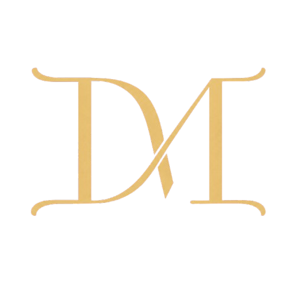

<!DOCTYPE html>
<html lang="es">
<head>
    <meta charset="UTF-8">
    <meta name="viewport" content="width=device-width, initial-scale=1.0">
    <title>Darrmilly Studio</title>
    <!-- Importamos la tipografía Lora desde Google Fonts -->
    <link rel="preconnect" href="https://fonts.googleapis.com">
    <link rel="preconnect" href="https://fonts.gstatic.com" crossorigin>
    <link href="https://fonts.googleapis.com/css2?family=Lora:ital,wght@0,400..700;1,400..700&display=swap" rel="stylesheet">
    <!-- Vinculamos el archivo de estilos CSS -->
    <link rel="stylesheet" href="style.css">
</head>
<body>

    <main class="container">
        <!-- Banner superior -->
        <header class="hero-banner">
            <h1 class="title">WELCOME TO DARRMILLY STUDIO</h1>
            <!-- Aquí va tu logo (image_2.png) -->
            
        </header>

        <!-- Ilustración central (image_1.png) -->
        <section class="illustration-container">
            
        </section>

        <!-- Pie de página / Autoría -->
        <footer class="author-section">
            
by

            

                <h2 class="author-name">MARIA DUNN</h2>
                
Visual Quotes & Digital Design

            

        </footer>
    </main>

</body>
</html>/* Reset básico para evitar márgenes raros */
* {
    margin: 0;
    padding: 0;
    box-sizing: border-box;
}

body {
    background-color: #FFFBF4; /* Fondo crema cálido */
    font-family: 'Lora', serif;
    display: flex;
    justify-content: center;
    align-items: center;
    min-height: 100vh;
    padding: 20px;
}

/* Contenedor principal de la página */
.container {
    width: 100%;
    max-width: 600px;
    display: flex;
    flex-direction: column;
    align-items: center;
    gap: 40px; /* Espacio entre secciones */
}

/* Banner superior rojo */
.hero-banner {
    background-color: #7E1515; /* Rojo vino oscuro */
    width: 100%;
    padding: 30px 20px;
    border-radius: 20px; /* Bordes redondeados */
    text-align: center;
    box-shadow: 0 4px 10px rgba(0, 0, 0, 0.05);
}

.title {
    color: #D4AF37; /* Dorado */
    font-size: 1.4rem;
    font-weight: 500;
    letter-spacing: 2px;
    margin-bottom: 20px;
}

/* Estilo para el logo DM */
.logo {
    height: auto;
    width: 80px; /* Ajusta este tamaño según prefieras */
    display: block;
    margin: 0 auto;
}

/* Contenedor de la ilustración central */
.illustration-container {
    width: 100%;
    display: flex;
    justify-content: center;
    padding: 10px 0;
}

.main-illustration {
    max-width: 100%;
    height: auto;
    width: 200px; /* Ajusta el tamaño de la ilustración */
}

/* Sección del autor */
.author-section {
    display: flex;
    align-items: center;
    gap: 15px; /* Espacio entre el círculo y el texto */
    margin-top: 10px;
}

/* El círculo con el "by" */
.by-badge {
    background-color: #7E1515;
    color: #D4AF37;
    font-style: italic;
    font-size: 1rem;
    width: 40px;
    height: 40px;
    border-radius: 50%;
    display: flex;
    align-items: center;
    justify-content: center;
    font-weight: 500;
}

/* Texto del autor */
.author-text {
    display: flex;
    flex-direction: column;
}

.author-name {
    color: #7E1515;
    font-size: 1.3rem;
    font-weight: 500;
    letter-spacing: 1px;
    line-height: 1.2;
}

.author-sub {
    color: #7E1515;
    font-size: 0.9rem;
    font-style: italic;
    opacity: 0.9;
}
