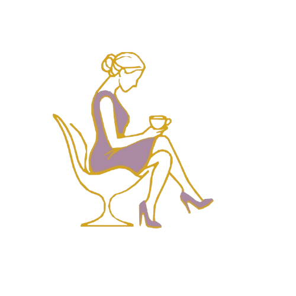

<!DOCTYPE html>
<html lang="es">
<head>
<meta charset="UTF-8">
<meta name="viewport" content="width=device-width, initial-scale=1.0">
<title>DarrMilly Studio</title>
<link rel="preconnect" href="https://fonts.googleapis.com">
<link rel="preconnect" href="https://fonts.gstatic.com" crossorigin>
<link href="https://fonts.googleapis.com/css2?family=Lora:ital,wght@0,400;0,500;1,400&display=swap" rel="stylesheet">

</head>
<body>
  

    

      <h1>Welcome to DarrMilly Studio</h1>
      
    

    

      
      

        
by

        

          <h2>MARIA DUNN</h2>
          
Visual Quotes &amp; Digital Design

        

      

    

  

</body>
</html>
